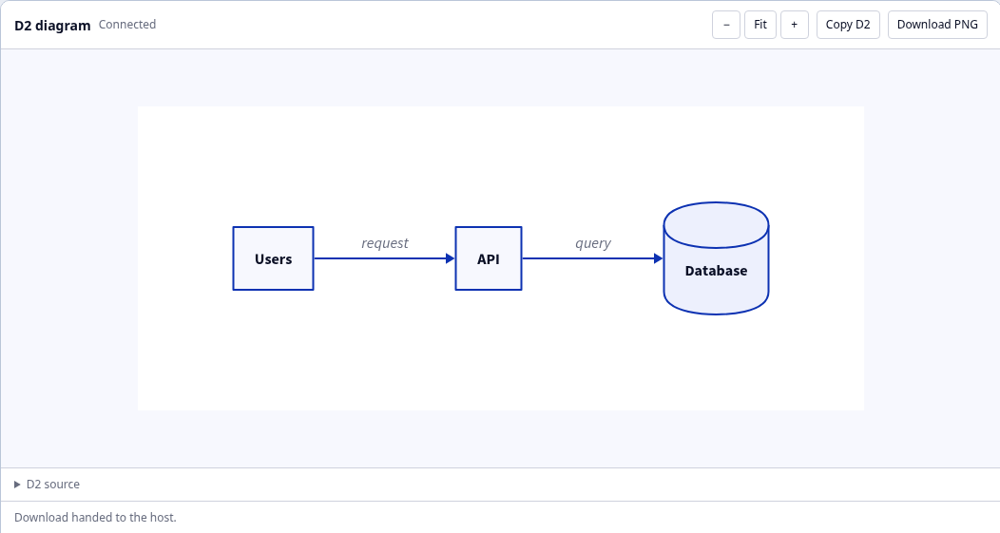

# Optional MCP Apps viewer

```sh
go build -o d2-mcp .
./d2-mcp --transport http --port 8080 --ui
```

Connect an MCP Apps client to `http://127.0.0.1:8080/mcp`. Stdio also supports
`--ui`. The flag defaults off; ordinary tool results work without a viewer.
Release 1.2.0 does not include this feature. No Node runtime is needed to run the
Go binary: it embeds the built HTML.

For VS Code, merge into `.vscode/mcp.json`:

```json
{"servers":{"d2":{"type":"http","url":"http://127.0.0.1:8080/mcp"}}}
```

For remote clients, use your deployed HTTPS endpoint and its authentication.
A remote client cannot reach your laptop's loopback address. The separate
Cloudflare deployment branch serves ordinary tools with the viewer disabled.

| Client | Documented inline UI support (checked 2026-10-12) |
| --- | --- |
| ChatGPT | [MCP Apps compatibility](https://developers.openai.com/plugins/changelog); [custom connection setup](https://developers.openai.com/plugins/deploy/connect-chatgpt) depends on account/admin policy |
| Claude chat, Desktop and mobile | [Interactive connectors](https://support.claude.com/en/articles/13454812-use-interactive-connectors-in-claude) |
| VS Code | [Built-in MCP Apps support since 1.109](https://code.visualstudio.com/updates/v1_109#_support-for-mcp-apps) |
| Codex Desktop; Claude Code Desktop/CLI | Native inline MCP Apps rendering unverified; ordinary MCP tool support alone does not establish it |
| OpenCode Desktop | No documented native support; [feature request remains open](https://github.com/anomalyco/opencode/issues/10884) |

These are product support references, not end-to-end tests of this viewer in
those products. Testing uses the official MCP Apps bridge in a sandboxed browser
harness. Ordinary SVG/PNG/ASCII tool results remain usable without inline UI.

## Use

Preview SVG/PNG/ASCII, drag to pan, and use zoom/fit. The viewer preserves the
rendered diagram's D2 styling and colors. Ask the agent to change source, layout
or theme through the existing `render-d2` tool. There is no local editor or
second diagram state for the agent to track.

**Copy D2** copies the complete source supplied in the tool's `code` input. If
the host blocks clipboard access, it selects the read-only source for manual
copying. File/document inputs can be previewed, but their source is not fetched;
Copy D2 is disabled when source is unavailable.

**Download PNG** exports the decoded image through a canvas when the host
supports downloads, subject to its approval policy. Use the ordinary MCP result
for original SVG. Host updates and cancellation discard pending image decodes.



## Compatibility and boundaries

The official `@modelcontextprotocol/ext-apps` bridge handles UI messaging and
downloads. The viewer makes no tool calls and needs no `serverTools` capability.
It requests the standard `clipboardWrite` permission, with a manual fallback;
it never reads the clipboard. PNG downloads require `downloadFile` and the
button is hidden when unsupported.

`--ui` publishes a static `ui://d2/viewer` resource. Tool metadata is negotiated
per request. Legacy stateless HTTP before `2026-07-28` may lack capabilities on
later requests; with `--ui`, those requests receive optional metadata. Explicitly
unsupported clients do not. Current HTTP, stdio and SSE use known capabilities;
no capability cache or session store is added.

SVG is displayed as an inert image, never inserted into the document. Text uses
text-only DOM properties. The bundled page permits no network or child frames
and uses a hash-pinned script CSP. Preview limits are 256 KiB source, 2 MiB SVG,
16 MiB PNG, 8192 pixels per side and 16 megapixels; they do not guarantee bounded
arbitrary browser rendering complexity.

## Build and test

With Node 24+, from `apps/`:

```sh
npm ci --ignore-scripts
npm run build
npx playwright install chromium
go build -o ../d2-mcp ..
D2_MCP_TEST_BINARY="$(cd .. && pwd)/d2-mcp" npm test
```

For an installed browser, set `PLAYWRIGHT_CHROMIUM_EXECUTABLE_PATH`. CI checks the
embedded HTML matches the source and runs browser tests against the Go server.
